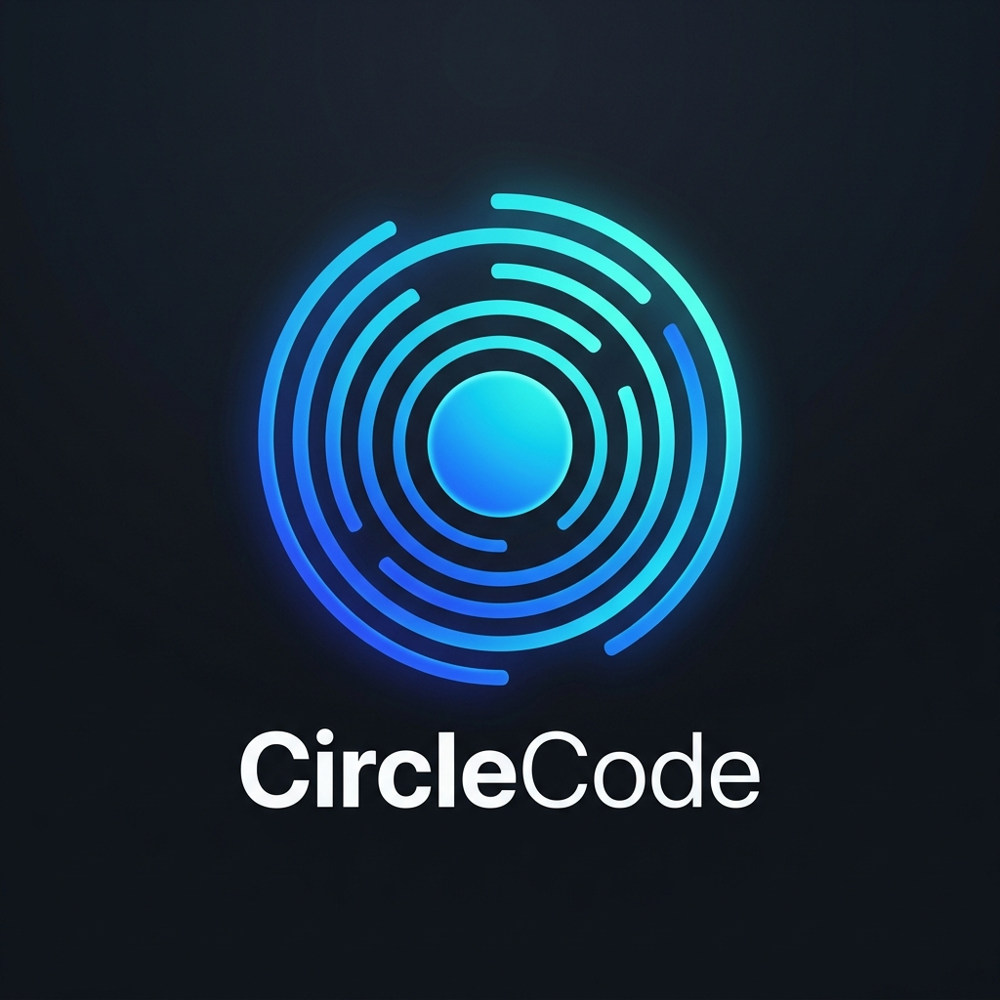
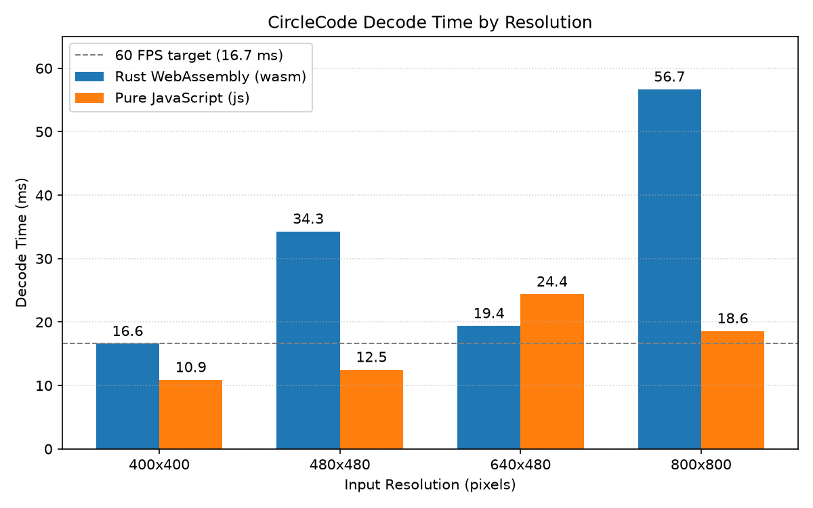
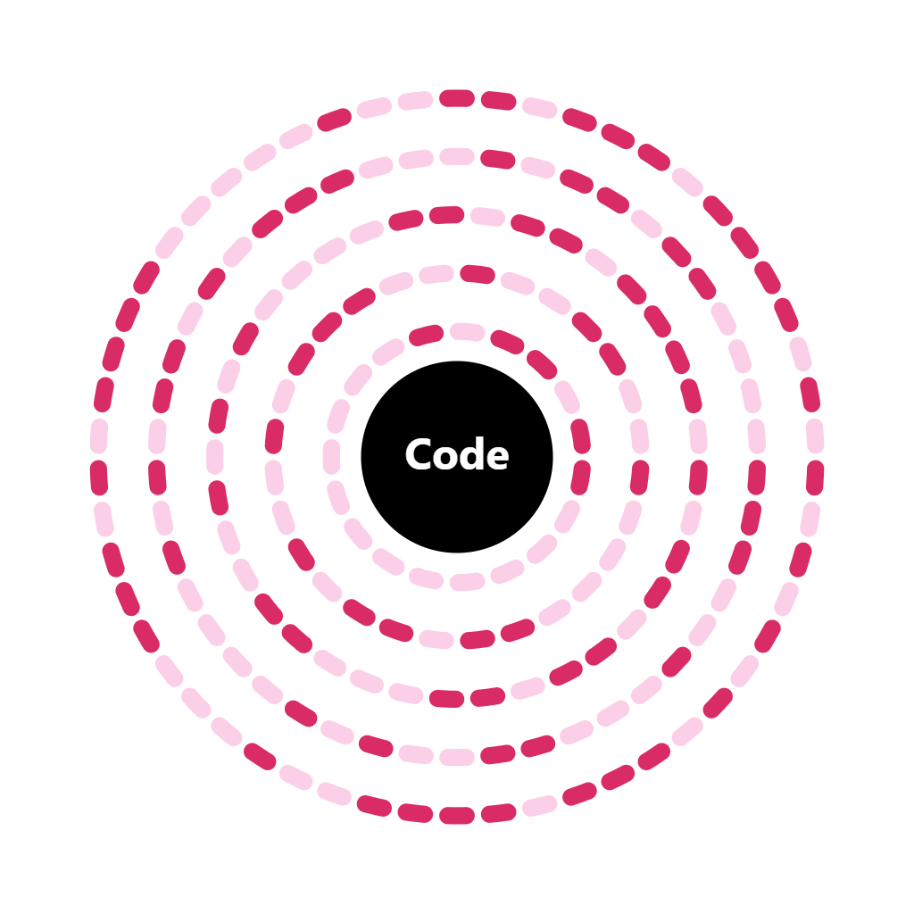
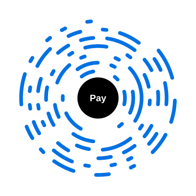

# CircleCode

<p align="center">
  
</p>
<h2 align="center">High-performance, dependency-free circular barcode codec for Browser and Node.js</h2>
<p align="center">
  Generate elegant circular barcodes in dual modes (<b>Circle</b> discrete dashes &amp; <b>LonCle</b> connected sweeping arcs) with custom center branding, and scan them across full 360° rotations at native speeds.
</p>
<p align="center">
  <a href="https://github.com/Axphia/CircleCode/actions/workflows/build-and-publish.yml"></a>
  <a href="https://www.npmjs.com/package/@axphia/circlecode"></a>
  <a href="https://www.jsdelivr.com/package/npm/@axphia/circlecode"></a>
  <a href="https://circlecode.js.org"></a>
  <a href="https://github.com/Axphia/CircleCode"></a>
  
  
  
</p>

---

## Dual Rendering Modes

CircleCode officially supports two distinct visual styles while maintaining 100% optical scanning compatibility:

| Mode | Option | Visual Representation | Use Case |
| :--- | :--- | :--- | :--- |
| **Circle** | `style: 'circle'` | **Classic discrete dashed pills** for each individual bit slot. | High-contrast industrial labels, technical tags, and classic circular codes. |
| **LonCle** | `style: 'loncle'` *(or `loncle: true`)* | **Continuous sweeping variable-length arcs** merging contiguous 1-bits. | Modern apps, payment cards, luxury merchandise, badges, and posters. |

Both modes preserve exact angular slot center alignment, allowing the same scanner engine to decode both modes with zero configuration.

---

## Documentation & Policies

- **[Documentation Hub & Benchmarks](docs/README.md)** — Complete technical documentation and empirical performance benchmarks.
- **[Changelog](CHANGELOG.md)** — Release history and version notes.
- **[API Reference (v1.1.7)](docs/API.md)** — Complete function signatures, options, and TypeScript definitions.
- **[Technical Specification](docs/SPECIFICATION.md)** — Format geometry, dash angles, header encoding, and error correction.
- **[System Architecture](docs/ARCHITECTURE.md)** — Dual-engine design, subpixel image pipeline, and threading models.
- **[Native Rust Core](native/README.md)** — Compiling and benchmarking the WebAssembly module.
- **[Accessibility Statement (WCAG 2.1 AA)](ACCESSIBILITY.md)** — Semantic SVG attributes (`role="img"`, `aria-label`, `<title>`, `<desc>`), contrast ratios, and screen reader support.
- **[Security Policy](SECURITY.md)** — XSS/SVG sanitization safeguards, URL protocol whitelisting, and vulnerability reporting.
- **[Contributing Guidelines](CONTRIBUTING.md)** — Local setup, coding standards, and pull request workflow.
- **[Code of Conduct](CODE_OF_CONDUCT.md)** — Community standards and expectations.

---

## Engine Selection: Pure JS vs Native Rust WASM



| Engine | Recommended Use Case | Frame Latency | Why use it? |
| :--- | :--- | :--- | :--- |
| **Pure JavaScript** (`@axphia/circlecode`) | **Web Image Uploads & File Decoding** | Device-dependent | **Zero dependencies**, without fetching `.wasm` binaries. Suitable for file uploads, static images, and Node.js scripts. |
| **Native Rust WASM** (`@axphia/circlecode/wasm`) | **Camera Scanning** | Device-dependent | Compiled Rust decoder. Measure both engines on the target device; speed, CPU use, and thermals depend on the workload. |

Run `npm run test:wasm` for local synthetic-image timings. These are single-run correctness checks, not a representative benchmark or a camera/UI FPS guarantee. See [measurement guidance](native/README.md#measuring-performance).

---

## Features

- **Dual Visual Modes (Circle & LonCle):** Choose between classic discrete pill dashes or fluid, variable-length sweeping connected ribbons.
- **Zero Dependencies:** Pure vanilla JavaScript default. Runs out-of-the-box in Node.js, modern browsers, PWAs, or embedded webviews.
- **Native WebAssembly Decoder (`@axphia/circlecode/wasm`):** An alternative decoder compiled from Rust; measure performance on the target device.
- **Non-Blocking Web Worker:** Dedicated background worker (`scanner-worker.js`) decouples CPU-heavy decoding from the UI thread so the interface can remain responsive.
- **Perspective & Tilt Recovery:** Automatically corrects for camera angles (15°–30° tilt) and elliptical distortion.
- **Subpixel 360° Scanning Engine:** Dual-centroid edge detection, scale-aware radial search (`dr = 2.2 * scale`), and hybrid Otsu/K-means thresholding for extreme reliability under shadows and glare.
- **Live Camera & Mobile Features:** Integrated torch (flashlight) toggle, digital zoom crop, and 1-frame instant lock when checksum matches.
- **Accessible Vector SVG & Canvas Support:** Export crisp, high-resolution SVG markup with built-in WCAG 2.1 AA accessibility metadata (`role="img"`, `aria-label`, `<title>`, `<desc>`) and strict XML/URL sanitization, or render directly to 2D canvas contexts.
- **Center Branding Badge:** Dedicated center circular slot ($R=42$) for brand icons, text, or avatars with zero data occlusion.
- **Universal Module Support (v1.1.7):** Full support for ECMAScript Modules (`import`), CommonJS (`require`), TypeScript types (`index.d.ts`), and standalone UMD browser bundle.

---

## Live Demos

- **Generator:** [https://circlecode.js.org/web-use-demo/generator.html](https://circlecode.js.org/web-use-demo/generator.html)
- **Live Camera Scanner (JS):** [https://circlecode.js.org/web-use-demo/scanner.html](https://circlecode.js.org/web-use-demo/scanner.html)
- **Live Camera Scanner (WASM):** [https://circlecode.js.org/web-use-demo/scanner-wasm.html](https://circlecode.js.org/web-use-demo/scanner-wasm.html)
- **WASM Benchmark:** [https://circlecode.js.org/web-use-demo/wasm-demo.html](https://circlecode.js.org/web-use-demo/wasm-demo.html)
- **Comparison Showcase:** [https://circlecode.js.org/web-use-demo/example.html](https://circlecode.js.org/web-use-demo/example.html)
- **Studio Home:** [https://circlecode.js.org](https://circlecode.js.org)

---

## Quick Installation

```bash
# Install from NPM Registry
npm install @axphia/circlecode

# Or install from GitHub Packages (Axphia scope)
npm install @axphia/circlecode --registry=https://npm.pkg.github.com

# yarn
yarn add @axphia/circlecode

# pnpm
pnpm add @axphia/circlecode

# bun
bun add @axphia/circlecode
```

### Standalone Browser CDN

Include directly via script tag in vanilla HTML:

```html
<!-- Standalone UMD Bundle (v1.1.7) -->
<script src="https://cdn.jsdelivr.net/npm/@axphia/circlecode@1.1.7/dist/circlecode.min.js"></script>
<script>
  const { buildModel, renderToCanvas, renderToSVG, scanCanvas, CircleScanner } = window.CircleCode;
</script>
```

---

## Quick Start

### 1. Generating Codes (Encoder)

#### Render Scalable SVG (LonCle Mode)
```javascript
import { buildModel, renderToSVG } from '@axphia/circlecode';

// 1. Build circular code data model (supports 4 to 14 rings)
const model = buildModel('Table-24', { rings: 5, density: 0.35 });

// 2. Generate pure vector SVG in LonCle mode (connected sweeping arcs)
const svg = renderToSVG(model, {
  style: 'loncle',
  dark: '#0071e3',
  light: '#ffffff',
  center: 'Pay',
  centerBg: '#000000'
});

console.log(svg);
```

#### Render to HTML Canvas (Circle Mode)
```javascript
import { buildModel, renderToCanvas } from '@axphia/circlecode';

const canvas = document.getElementById('myCanvas');
const ctx = canvas.getContext('2d');

const model = buildModel('user-12345', { rings: 5, density: 0.35 });

// Render in Circle mode (classic discrete dashes)
renderToCanvas(model, ctx, 400, {
  style: 'circle',
  dark: '#1d1d1f',
  light: '#8e8e93',
  center: 'MyBrand',
  centerBg: '#000000'
});
```

---

### 2. Pure JavaScript Scanner (Web Image Uploads & File Decoding)

Use the zero-dependency pure JavaScript scanner for user photo uploads, drag-and-drop file inputs, and canvas decoding:

#### Scan Static Image or Canvas Element
```javascript
import { scanCanvas, scanImageData, scanImage } from '@axphia/circlecode';

// A) Scan directly from an HTMLCanvasElement
const result = scanCanvas(canvas, { aggressive: false, perspective: true });

if (result.ok) {
  console.log('Decoded payload:', result.text);
  console.log('Rings detected:', result.rings);
  console.log('Rotation angle:', Math.round(result.rot * 180 / Math.PI) + '°');
} else {
  console.error('Scan failed:', result.reason);
}

// B) Scan from an uploaded  element or URL
const img = document.querySelector('img#uploadedCode');
const imgResult = await scanImage(img, { aggressive: true });
if (imgResult.ok) {
  console.log('Uploaded image payload:', imgResult.text);
}
```

#### Live Pure JS Camera Scanner (with Web Worker)
```javascript
import { CircleScanner } from '@axphia/circlecode';

const videoElement = document.getElementById('cameraVideo');

const scanner = new CircleScanner({
  fps: 12,
  useWorker: true, // Run frame decoding in a background worker
  workerUrl: 'scanner-worker.js',
  perspective: true,
  facingMode: 'environment',
  onScan: (result) => {
    console.log('Scanned successfully:', result.text);
    scanner.stop();
  }
});

// Start camera stream
await scanner.start(videoElement);

// Control camera torch
if (scanner.hasTorch()) {
  await scanner.toggleTorch();
}
```

---

### 3. Native Rust WebAssembly (WASM) Scanner

The compiled Rust WebAssembly core provides an alternative decoder for camera frames. Benchmark it on the target device before choosing an engine:

```javascript
import { ensureWasm, scanFrameWasm } from '@axphia/circlecode/wasm';

// 1. Initialize WebAssembly runtime
await ensureWasm();

// 2. Decode an RGBA pixel buffer (width * height * 4 bytes)
const start = performance.now();
const result = scanFrameWasm(rgbaPixelBuffer, 480, 480, true);
const elapsedMs = performance.now() - start;

if (result.ok) {
  console.log('WASM instant lock:', result.text);
  console.log('Payload length:', result.len, 'bytes');
  console.log('Rings detected:', result.rings);
  console.log('Latency:', elapsedMs, 'ms');
}
```

---

### 4. CommonJS Usage (Node.js)

```javascript
const { buildModel, renderToSVG, scanCanvas } = require('@axphia/circlecode');

const model = buildModel('Hello World');
const svg = renderToSVG(model, { dark: '#0071e3', light: '#ffffff' });
```

---

## Technical Specifications

| Parameter | Standard Value | Description |
| :--- | :--- | :--- |
| **Rendering Modes** | `Circle`, `LonCle` | Discrete dashes (`style: 'circle'`) vs contiguous sweeping arcs (`style: 'loncle'`) |
| **Center Radius** | `42` (normalized) | Protected circular branding slot for logos / icons |
| **Inner Ring Start** | `55` | Ring 0 start radius |
| **Outer Ring End** | `157` | Outermost ring radius |
| **Disc Edge Radius** | `190` | Outer boundary border |
| **Standard Density** | `0.35` | Dash density parameter ($d = 0.35$) |
| **Ring Counts** | `4` to `14` | Dynamically expandable for payloads up to 50+ bytes |
| **Checksum** | `Modulo-256 Sum` | 8-bit checksum with 1–2 bit mathematical error recovery |
| **Camera Latency** | Device-dependent | Decode time is separate from camera/UI FPS; measure on the target device |

---

## Development & Testing

```bash
# Clone the repository
git clone https://github.com/Axphia/CircleCode.git
cd CircleCode

# Start local interactive showcase server
npm run dev

# Run JavaScript test suite
npm test

# Run Rust WebAssembly test suite
npm run test:wasm

# Rebuild standalone UMD & CommonJS bundles
npm run build

# Recompile Rust WebAssembly core
npm run build:wasm
```

---

<p align="center">
  
  &nbsp;&nbsp;&nbsp;&nbsp;
  
</p>

## License

This project is open-source and available under the [MIT License](LICENSE).

Developed and maintained by [Axphia Project](https://github.com/Axphia).
