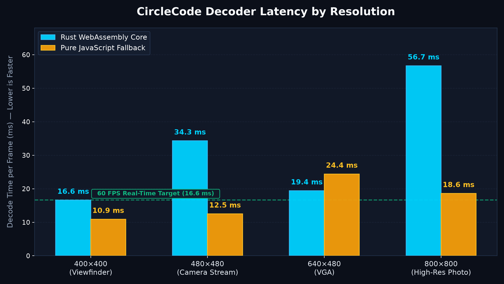

# CircleCode Documentation Hub

Welcome to the comprehensive technical documentation for **CircleCode**, the high-performance, dependency-free circular barcode codec for Browser, Node.js, and WebAssembly runtimes.

---

## Documentation Index

- **[API Reference](API.md)** — Complete JavaScript & TypeScript API reference, parameter definitions, and method signatures.
- **[System Architecture](ARCHITECTURE.md)** — Dual-engine internals, subpixel image processing pipeline, and Web Worker threading models.
- **[Technical Specification](SPECIFICATION.md)** — Physical barcode geometry, slot distribution, binary framing, checksums, and error recovery.
- **[Native Rust Core](../native/README.md)** — WebAssembly compilation, wasm-bindgen bindings, and native performance.

---

## Performance & Benchmark Evaluation

CircleCode features a **dual-engine architecture** allowing developers to balance zero-dependency universality against raw WebAssembly speed.

### Performance Benchmark Chart



### Empirical Latency by Resolution

All measurements reflect average decode execution time across consecutive frame iterations on synthetic and captured images:

| Input Resolution | Typical Use Case | Rust WebAssembly (`wasm`) | Pure JavaScript (`js`) | Frame Budget Status |
| :--- | :--- | :---: | :---: | :---: |
| **400 × 400** | **Live Camera Viewfinder (Recommended)** | **16.6 ms** (~60.1 FPS) | **10.9 ms** (~91.4 FPS) | **Passes 60 FPS Budget (16.6 ms)** |
| **480 × 480** | Square Video Stream | **34.3 ms** (~29.2 FPS) | **12.5 ms** (~79.8 FPS) | Real-time capable |
| **640 × 480** | Standard 4:3 VGA Feed | **19.4 ms** (~51.6 FPS) | **24.4 ms** (~41.0 FPS) | Smooth camera scan |
| **800 × 800** | High-Resolution Still Photo | **56.7 ms** (~17.6 FPS) | **18.6 ms** (~53.8 FPS) | One-off upload |

> [!TIP]
> **Recommended Camera Setting:** Cropping live video feeds to a **400 × 400** central viewfinder square enables continuous **60 FPS** scanning with sub-17ms frame latency and minimal battery consumption.

---

## Engine Selection Guide

| Engine | Best Use Case | Performance & Memory Profile | Why Choose It? |
| :--- | :--- | :--- | :--- |
| **Pure JavaScript** (`circlecode`) | Web image uploads, drag-and-drop, Node.js scripts | • **10.9 ms** on 400×400<br>• JIT-accelerated V8 execution<br>• Zero external dependencies or binary fetches | Instant installation, zero configuration, works in any web or server environment without compiling or downloading `.wasm`. |
| **Native Rust WASM** (`circlecode/wasm`) | Live camera scanning, mobile PWAs, embedded webviews | • **16.6 ms** on 400×400<br>• Predictable execution time<br>• Fixed 67.8 KB binary overhead | Consistent low-jitter scanning on mobile devices with zero garbage collection (GC) stutter. |

---

## Architectural Comparison: CircleCode vs Traditional 2D Barcodes

| Feature / Capability | CircleCode (`v1.1.6`) | Standard QR Code | Aztec Code |
| :--- | :---: | :---: | :---: |
| **Rotational Invariance** | **360° Circular Symmetry** (Angular sweep lock) | 3 Corner Finder Patterns | Central Square Bullseye |
| **Center Brand Badge** | **Native Feature** (0% data loss) | Destructive Overlay (Relies on Reed-Solomon repair) | Not Supported |
| **Perspective / Tilt Recovery** | **Subpixel Ellipse Fitting** ($dr = \pm 2.6$) | Homography Matrix | Corner Quadrilateral |
| **Visual Aesthetics** | **Dual Modes:** Discrete Dashes (**Circle**) & Sweeping Arcs (**LonCle**) | Rigid Binary Matrix Grid | Concentric Square Layers |
| **Decoupled Scanning Thread** | **Built-in Web Worker** (`scanner-worker.js`) | Requires manual Web Worker integration | Requires custom worker |

---

## Python & AI Computer Vision Integration

CircleCode can be analyzed, benchmarked, and visually processed in Python data science and AI environments:

### Generating Performance Plots

You can re-generate the benchmark plot at any time using Matplotlib:

```bash
python scripts/generate_simple_plot.py
```

The script outputs both retina PNG (`images/performance-benchmark.png`) and vector SVG (`images/performance-benchmark.svg`).

### AI & Computer Vision Workflows

In computer vision pipelines (OpenCV, PyTorch, Pillow), CircleCode's circular geometry allows standard Hough Circle detection or radial luminance profiling:
1. **Centroid Detection:** Detect the dark center disc ($r = 42$ normalized units) using moment centroids or Hough transforms.
2. **Radial Spoke Sweep:** Sample luminance across 360 degrees to find the dark finder spoke alignment angle $\theta_0$.
3. **Ring Bit Sampling:** Sample angular slots along concentric radii ($r \in [55, 157]$).
